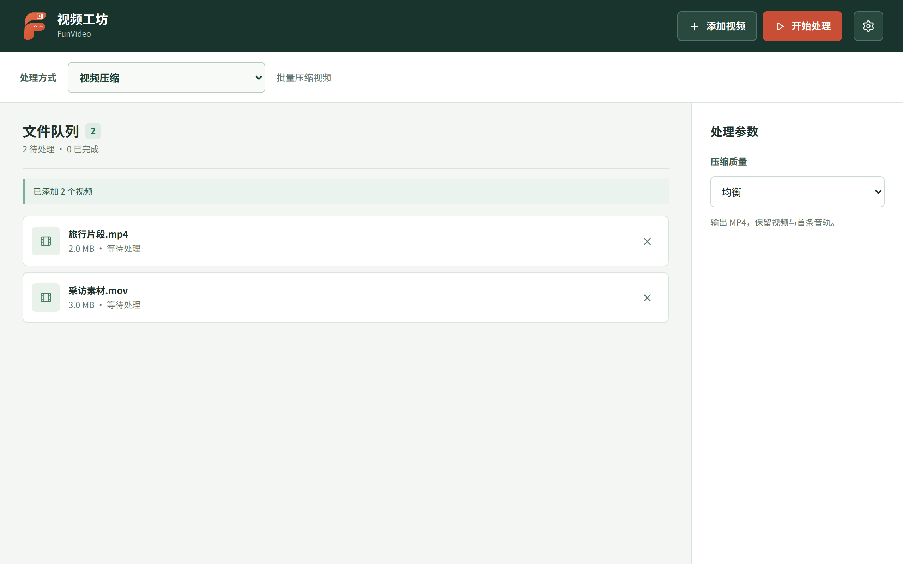

# 视频工坊 FunVideo

基于 [uTools FFmpeg 扩展](https://www.u-tools.cn/docs/api-reference/ffmpeg.html)的本地批量视频处理插件。支持压缩、时长与画面裁剪、尺寸与格式转换、图片水印、变速、转 GIF、旋转翻转、提取封面、定时抽帧，以及提取音频、静音、调整音量和替换背景音乐。

从 [v0.4.0 Release](https://github.com/farfarfun-utools/utools-funvideo/releases/tag/v0.4.0) 下载 `utools-funvideo-0.4.0.upxs`，导入 uTools 安装。也可在 CI 中下载开发版插件目录。

当前 `main` 分支正在开发下一版；替换背景音乐已进入开发版，尚未包含在 `v0.4.0` 安装包中。

## AI / MCP 工具

`queue_videos` 校验 1 至 100 个本机视频绝对路径并加入待处理队列。工具只返回文件名和大小，不读取视频内容，也不自动运行 FFmpeg 或写文件；用户仍需在插件中选择操作。需 uTools 8 的工具能力，第三方 Agent 还需由用户开启 uTools MCP 服务。

## 使用

在 uTools 开发者工具中选择 `utools/plugin.json` 导入开发版，或从 GitHub Actions 的 `utools-funvideo-developer-files` 下载完整插件目录后导入。输入“视频工坊”进入，也可在 uTools 中选中视频文件后使用“用视频工坊处理”。添加视频、选择处理方式，然后开始处理；输出位置可从右上角设置另选。首次使用时，uTools 会引导安装 FFmpeg 扩展。

任务串行处理，逐项显示进度和错误；可以取消当前任务、重试失败任务。复制视频文件后可在插件页面直接粘贴，文件 URL 或绝对路径文本也可粘贴。每次开始处理会在目标目录下创建精确到秒的 `FunVideo_YYYY-MM-DD_HH-mm-ss` 文件夹，同一秒再次处理自动追加序号。默认目标是本批首个视频所在目录，也可指定统一目标；源文件和已有结果都不会被覆盖。插件不上传视频，不保存文件历史。输出视频保留第一条视频轨和可选的第一条音轨；提取与调节音量需要源文件有音轨。水印使用本地图片；抽帧最多 100 张。转 GIF 默认取开头 5 秒，最长可设为 30 秒。WebM 转换依赖 uTools FFmpeg 扩展中提供 VP9/Opus 编码器，需在目标平台验收。

## 功能对照与后续复查

资料检索于 2026-11-02：[uTools 视频插件搜索](https://www.u-tools.cn/plugins/search/?t=%E8%A7%86%E9%A2%91)及各插件详情页。仅纳入本地视频加工；下载、云存储和在线 AI 服务不列入。每行只列一项功能；☑ 表示已有入口和处理逻辑，☐ 表示尚未实现。

| 原始插件 | 小功能 | 已实现 | 说明 |
| --- | --- | :---: | --- |
| [视频批量处理](https://www.u-tools.cn/plugins/detail/%E8%A7%86%E9%A2%91%E6%89%B9%E9%87%8F%E5%A4%84%E7%90%86/) | 视频压缩 | ☑ | MP4 |
| | 时长裁剪 | ☑ | |
| | 画面裁剪 | ☑ | 坐标与宽高 |
| | 格式转换 | ☑ | MP4、MKV、WebM |
| | 转为动图 | ☑ | GIF，最长 30 秒 |
| | 添加水印 | ☑ | 本地图片水印 |
| | 修改尺寸 | ☑ | 等比缩放 |
| | 提取封面 | ☑ | 指定时间点 |
| | 视频变速 | ☑ | 0.5 至 2 倍 |
| | 视频翻转 | ☑ | 水平或垂直 |
| | 视频旋转 | ☑ | 90° 或 180° |
| | 视频合并 | ☐ | 需兼容不同分辨率与缺失音轨 |
| | 提取音频 | ☑ | M4A |
| | 移除声音 | ☑ | |
| | 调整音量 | ☑ | |
| | 帧提取 | ☑ | 定时间隔，最多 100 张 |
| [视频转gif](https://www.u-tools.cn/plugins/detail/%E8%A7%86%E9%A2%91%E8%BD%ACgif/) | 视频转 GIF | ☑ | |
| [gif2video](https://www.u-tools.cn/plugins/detail/gif2video/) | GIF 转视频 | ☐ | 当前输入队列仅视频文件 |
| [音视频精灵](https://www.u-tools.cn/plugins/detail/%E9%9F%B3%E8%A7%86%E9%A2%91%E7%B2%BE%E7%81%B5/) | 替换背景音乐 | ☑ | 支持 MP3、M4A、WAV、FLAC、OGG；短音频自动循环 |
| | 提取背景音乐 | ☑ | |
| [音频剪辑](https://www.u-tools.cn/plugins/detail/%E9%9F%B3%E9%A2%91%E5%89%AA%E8%BE%91/) | 音量渐变 | ☐ | |

本插件特有的工作流是秒级独立批次目录、页面粘贴、逐项进度和失败重试。下一轮优先评估视频合并；实现前需核对不同分辨率、帧率和缺失音轨的组合。插件复用 uTools 已安装的 FFmpeg 扩展，不把 FFmpeg 二进制装入插件；插件目录以小于 5 MB 为目标。

## 开发与打包

界面使用原生 HTML/CSS/JavaScript，无前端构建依赖。图标源于 [farfarfun 品牌仓库](https://github.com/farfarfun/.github/tree/master/brand)的统一生成器。`utools/preload.js` 负责文件访问与调用 `utools.runFFmpeg()`，`utools/tasks.js` 负责生成参数。GitHub Actions 执行语法检查、测试和开发目录打包；本工作区不在本机运行构建、测试或打包。

`identity.json` 记录该插件的官方 ID `zyynr2j3`。组织 Secrets `UTOOLS_MID`、`UTOOLS_UID`、`UTOOLS_CELLPHONE` 可用时，CI 会调用组织现有的 `utools-devtools` 生成 UPXS。不要把私密身份文件提交进仓库。

## 许可

项目代码采用 MIT 许可证。FFmpeg 由 uTools 扩展提供，不包含在此仓库。
