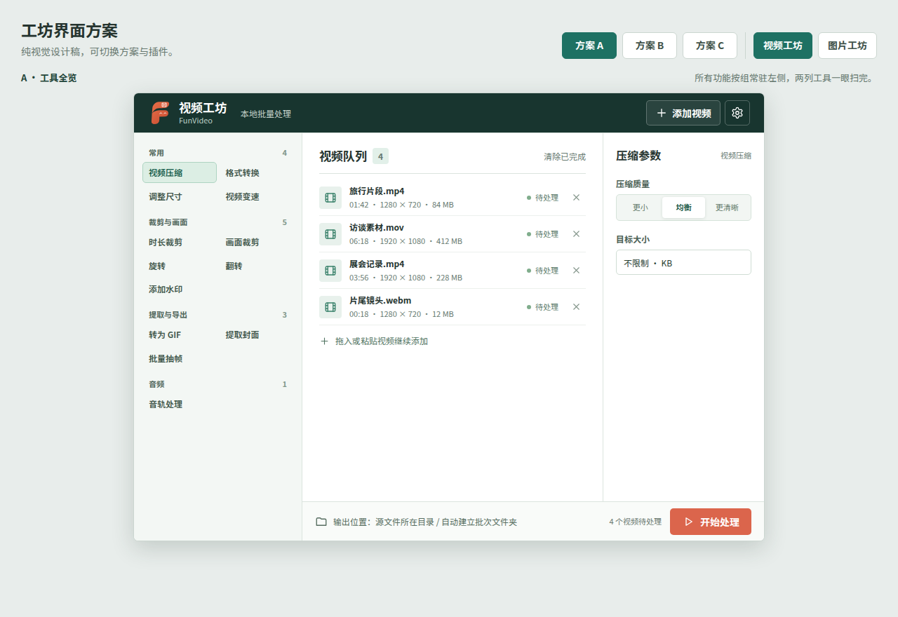
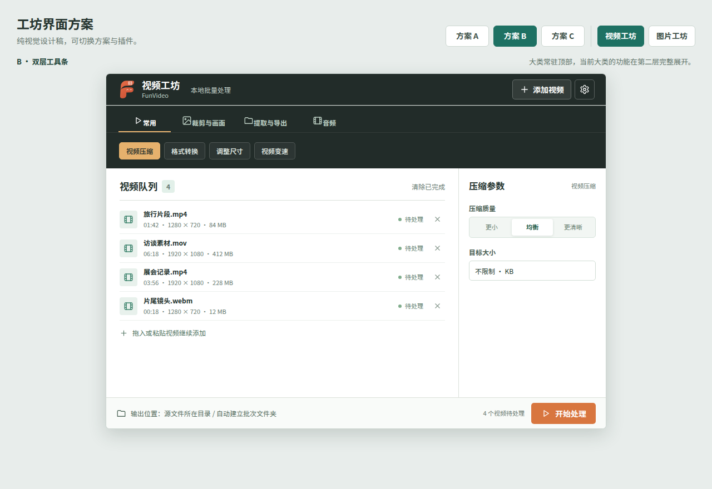
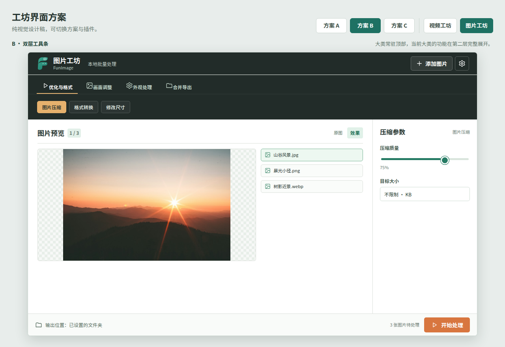
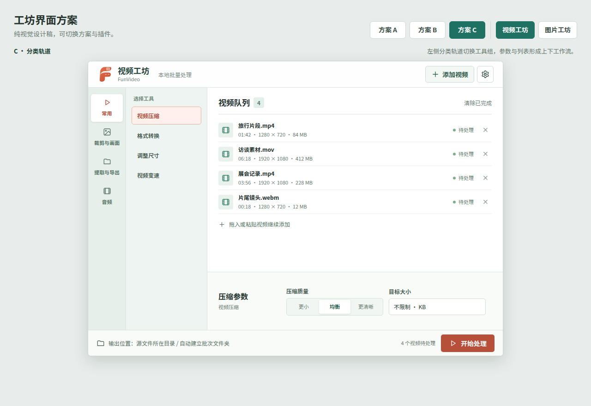
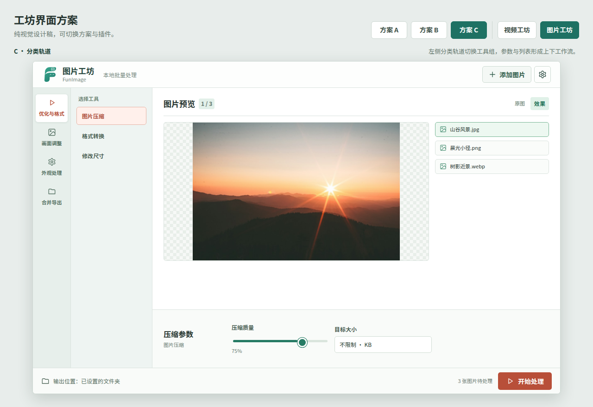

# 工坊界面设计稿

已选定 C · 分类轨道，并应用于两个插件。

以下是视频工坊和图片工坊共用视觉语言的三套静态方案。点击图片查看大图；这些设计稿只用于选择界面方向，尚未接入文件处理。

| 方案 | 视频工坊 | 图片工坊 |
| --- | --- | --- |
| A · 工具全览：全部功能按组常驻左侧 |  |  |
| B · 双层工具条：顶部选大类，第二层显示工具 |  |  |
| C · 分类轨道：左侧分类与工具，底部放参数 |  |  |

下载后可打开 [交互式对比页](index.html)，切换方案、插件和功能查看不同状态。
